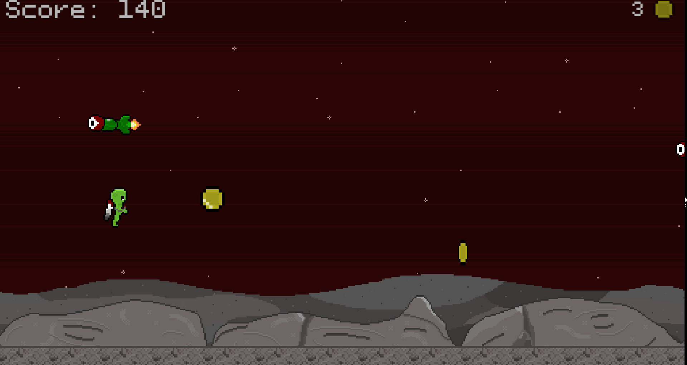
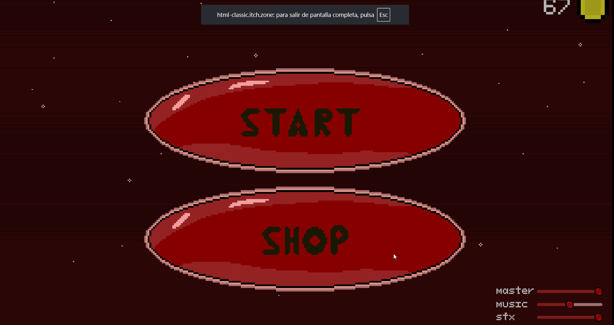

# Alien Jetpack

Juego endless runner estilo Jetpack Joyride, hecho en Unity para mejorar mi programación.

## Features
- Control del personaje con jetpack basado en físicas
- Generación procedural de obstáculos aleatorios
- Dificultad progresiva según la puntuación
- Tienda de aspectos que se compran con dinero del juego, con guardado de progreso mediante PlayerPrefs y uso de ScriptableObjects
- Audio con FMOD

## Mi rol
Programación, arte y diseño (proyecto en solitario).

## Scripts relevantes
- [`PlayerMovement.cs`](https://github.com/rodei0/JetpackGame/blob/main/Assets/Scripts/Player/PlayerMovement.cs): físicas del jugador
- [`SpawnerController.cs`](https://github.com/rodei0/JetpackGame/blob/main/Assets/Scripts/Obstacles/SpawnerController.cs): generación de obstáculos y lógica de cada uno de ellos
- [`SkinManager.cs`](https://github.com/rodei0/JetpackGame/blob/main/Assets/Scripts/Skin/SkinManager.cs): compra y equipado de aspectos
- [`DataManager.cs`](https://github.com/rodei0/JetpackGame/blob/main/Assets/Scripts/Managers/DataManager.cs): guardado con PlayerPrefs
- [`AudioManager.cs`](https://github.com/rodei0/JetpackGame/blob/main/Assets/Scripts/Managers/AudioManager.cs): integración con FMOD

## Jugar
https://rodei.itch.io/alien-jet

## Créditos
SFX: Pixabay
